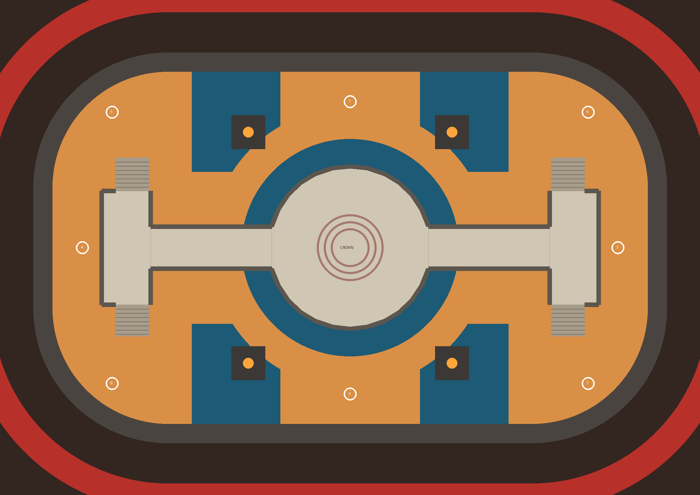

# Chita — Design Pillars & Crown Mode

Status: proposal, 2026-11-26. Research + diagnosis of the current 4-player FFA, then the plan.

## 1. Where the pillars come from

| Game | What it does | Lesson for Chita |
|---|---|---|
| Brawl Stars | 3v3, <3 min matches, 1 attack + 1 super + small kit per brawler | Short cheap rounds, tiny kits, bold readability |
| Battlerite / Bloodline Champions | All skillshots, zero RNG, damage cuts max HP | Skill in, no dice out. Fights must end. Died because rank was the only thing to chase |
| Supervive | MOBA + BR hybrid, dead in 7 months | "Tried to do too much." One mode nailed before a second |
| Brawlhalla | One-button specials, F2P, weekly free roster, 10+ years | Simple inputs, high payoff, rotating content |
| The Strongest Battlegrounds / Blade Ball (Roblox) | One sharp verb (parry / deflect) carries the game | Defensive counterplay is core, not a bolt-on |
| Marvel Rivals / Deadlock | Rivals: hard to read, roster bloat. Deadlock: duels readable | Readability over spectacle. Small roster, drip-feed |

## 2. Pillars

1. **Readable at all times.** Every projectile, zone and dash has a telegraph and a hit confirm. Top-down 2D is our edge; do not bury it in VFX.
2. **Skill in, no dice out.** Skillshots, dodges, parries decide fights. Input randomness (drops, events) yes; output randomness (crits, miss) no.
3. **Small kit, big decisions.** Basic + skill + passive + ult. Depth from timing and counterplay, not button count.
4. **Short, cheap rounds.** Under 4 min. A loss costs nothing, so you queue again.
5. **Fights must end.** Something always forces the fight to resolve (crown pull, ring, bleed).
6. **Small roster, sharp identity.** 5–8 heroes, each is an answer to another. Add one at a time.
7. **Something to chase after the match.** Cosmetics, hero mastery, rotating heroes. Never power.
8. **Scope discipline.** One mode nailed before any second. Never split modes into separate clients.

## 3. Why the current FFA feels mindless

Read from `pvp_match.gd`, `player.gd`, `spells/*`:

- Only one decision exists: hit the nearest guy. Kill race to 15, 3 s respawn, death costs nothing. No reason to position, wait, retreat or pick a target.
- FFA deathmatch rewards the vulture. Two fight, the third cleans up. In kill-count that is the correct play, so everyone pokes and nobody commits.
- Every signature skill stuns (hook, snipe, step, charge, ember). The fight pattern is stun → mash combo → repeat. No bait / block / punish layer.
- Kit is 2 buttons + dash. Nothing to save, spend or charge.

Balance is a later problem. Fix decisions first.

## 4. Crown mode (the fix, step 1)

Objective FFA. Target choice becomes "who has the crown", not "who is closest". Everyone hunting the leader is a negative feedback loop that creates drama for free (Brawl Stars Hot Zone / Gem Grab, Smash Crown).

| Rule | Value | Why |
|---|---|---|
| Crown spawns at centre | 5 s after FIGHT | Everyone converges |
| Holder scores | 1 pt / s | Simple, readable |
| Win | first to 60 pts | ~2.5–4 min matches |
| Kills | 0 pts, still on the board | Kills are a means, not the goal |
| Kill the holder | +2 pts to the killer | Vulture still has a reason, but it is the holder he wants |
| Holder burden | no dash, −15% speed, crown beam + radar ring | The king cannot run. Drama needs a target that cannot escape |
| Holder dies | crown drops where he died, 2 s before pickable | No instant steal chains |
| Nobody holds it for 10 s | crown teleports to centre | Kills hide-and-seek |
| Stall check (later) | holder past 40 pts → others get a speed "hunt" buff | Skill-based catch-up, not free points |

Implementation: `GameMode.CROWN`, `scripts/crown_pickup.gd`, scoring + crown RPCs in `pvp_match.gd`, holder burden in `player.gd`, board shows SCORE in `match_hud.gd`. Classic and Friendslop untouched.

## 5. Hero shape: basic + skill + passive + ult

- **Passive** changes how the basic or skill behaves, never a stat stick. Rogue: backstab bonus. Knight: blocks hits while charging. Mage: ember ticks heal you. Bonker: hooked target takes extra from the next 2 bonks. Ranger: stand still 1 s → next basic pierces.
- **Ult** charges from damage dealt + taken (~2 per life). Never from time (rewards hiding). One big screen moment per hero.
- With 4 slots, cut stuns to **hook + charge only**. Ults may stun. Snipe → heavy knockback, Step → backstab window, Ember → slow + burn. Stun becomes scarce, so dodging it matters.
- Give every skill a visible whiff recovery (0.3–0.4 s). Dodge → free hit. Telegraph, dodge, punish.

### 5.0 Archetypes (every hero starts here)

One word per hero, and every slot must serve it. The basic alone should tell you which hero it is with your eyes shut.

| Hero | Archetype | Fantasy | Basic (LMB) | Reads as |
|---|---|---|---|---|
| Knight | **Tank** | Takes hits head-on, holds the front, launches people | **Cleave**: 0.5 s, 125 px, 155° arc, 0.16 s windup, 14 dmg, 3rd swing 1.8x + launch | Slow, wide, heavy, orange |
| Rogue | Stab | **Shadow Rush**: blink 380 px in a line; everyone passed takes 8 and is **Frozen** 0.8 s (no move / dash / turn, can still attack the locked way). 6 s cd | **Backstab**: 1.8x from behind. Rush through a foe that faces you = you land at its frozen back | **Smoke Screen** (Riki): cloud r200 at the cursor for 6 s. Foes inside miss 50% of their hits; the Rogue inside is invisible to others, can't be locked onto, and every stab is a backstab. Area hits still find him. Cost 70 | Built |
| Ranger | Arrow | **Power Shot**: hold to draw (slowed), aim free, release. Draw 0→1 s: dmg 13→42, range 450→1100, knockback 100→650; full draw pierces 3. 5 s cd | **Steady Aim**: standing still draws 2x faster | **Focus Fire** (Windranger): 4 s of auto-fire at the foe near the cursor, 3x attack rate, 70% damage per arrow; move and Power Shot freely. Cost 150 | Built |
| Mage | Fire Orb | **Ember Field**: eruption 16 dmg + slow to 40% for 1.4 s, then 3.5 s burn + 55% slow. 7 s cd | **Kindling**: every Mage hit adds 1 **Burn** stack to the target: 1 dmg/s per stack, max 12, one stack fades every 1.2 s. Field ticks count as hits | **Meteor**: cursor up to 620 px, 1 s telegraph, r170 = 40 dmg + launch outward. Cost 80 | Built |

Mage feedback ("doesn't feel like a mage") was the old rapid-fire bolt with a 3-way fan: that is a gunner. The orb makes the basic a cast at a place, matching Ember Field and Meteor.

No basic auto-lunges any more (the "rush forward" was a 500–600 px/s step on every swing plus a 250 px step-in when locked). Holding LMB still walks you up to a target (hold-to-chase). Step-in is a playtest toggle.

**Playtest toggles** (Esc menu, saved per machine in `user://play_settings.cfg`, never synced): *Attack aim* Mouse / Facing (attacks go the way you walk; ground skills land 280 px ahead) and *Melee step-in* Off / On.

### 5.1 Kit table

Slots: LMB basic · RMB skill · passive (no button) · F/E ult (gamepad Y). **Every skill always casts**: a cursor beyond reach casts at full range that way (a ground / area ult with nobody near still goes: Judgement leaps full range, Meteor and Arrow Rain land at max range). **Targeted ults keep needing a target**: Assassinate and Focus Fire (and the unused Shackleshot, Shadow Dance) do nothing with nobody near the cursor and keep their charge ("Nobody in reach"). `Spell.worth_casting()` is the bots-only check so they don't waste charge; a basic aimed at a far foe fires at once while holding still walks you in. **Ult charge:** 1 per damage dealt, 0.35 per damage taken; cost 140–180 per hero (`Hero.ult_cost`, about one ult per life); kept through death; nothing charges it until the last ult is fully over (`Spell.ult_lock()`: an ult's own ticks never pay for the next). Durations trimmed: Guardian Angel 3 s, Smoke Screen 4.5 s, Thunderstorm 3.5 s, Blade Ring 3.5 s, Focus Fire 4 s.

| Hero | LMB | RMB | Passive | Ult | Status |
|---|---|---|---|---|---|
| Rogue | Backstab combo | **Shadow Rush**: blink 380 px in a line; everyone passed takes 8 and is **Frozen** 0.8 s (no move / dash / turn, can still attack the locked way). 6 s cd | **Backstab**: 1.8x from behind. Rush through a foe that faces you = you land at its frozen back | **Shadow Dance**: mark up to 3 foes in 520 px, 0.35 s later blink behind each and stab (max 2 per foe). Untargetable while dancing | Built |
| Knight | Flame Slash | Shield Charge: stun, pin on rocks | **Bulwark**: 25% less damage from hits on the side he faces (aim_dir · hit > 0.3), "BLOCK" pops on big hits. Counter to a Rogue who misses the flank | **Judgement**: leap up to 420 px over rocks (0.5 s, untouchable), gold landing circle shows the whole time, slam r150 = 26 dmg + 1 s stun + shove out. Needs a foe near the landing spot. Cost 90 | Built |
| Mage | Fire Bolt | **Ember Field**: no stun now. Eruption = 16 dmg + slow to 40% for 1.4 s (outlasts the field), then 3.5 s burn + 55% slow. 7 s cd | **Kindling**: every burn tick on a foe heals the Mage 2 (half the tick). 3 foes in the fire = real sustain | **Meteor**: cursor up to 620 px, 1 s telegraph (circle + falling rock), r170 = 40 dmg + launch outward (950 centre → 520 rim). No stun; ring-out tool. Needs a foe in the circle. Cost 80 | Built |
| Ranger | Flame Arrow | **Power Shot**: HOLD to draw (slowed to 50%), aim free the whole time, RELEASE to fire. Draw 0→1 s: dmg 13→42, range 450→1100, speed 900→1800, knockback 100→650. Full draw pierces 3, gold line + ding. Auto-fires at 2.5 s. Stun or dash drops the draw (no cd). 5 s cd. No stun | **Steady Aim**: standing still draws 2x faster (full in 0.5 s) | **Arrow Rain**: cursor up to 650 px, 0.4 s delay, r160 for 3 s, volley every 0.3 s = 6 dmg + slow 60% (silent, no push). Needs a foe in the circle. Cost 75 | Built |
| Paladin | **Hammer** (Dawnbreaker): thrown 260 px, hangs 0.12 s, flies back to the Paladin; hits once going out and once coming back (2 damage windows), 12 + 8% current HP each. 0.85 s cd | **Purification**: heal 30 and deal 30 to every foe within 150. 8 s cd | **Holy Might**: hammer scales with your HP; 25% of all your damage heals you | **Guardian Angel**: 3 s of no damage taken, your hits heal 50% more. Cost 170 | Built |
| Shade | **Dagger**: thrown, 330 px, 0.4 s, 9 dmg, homes on a locked foe, no slow | **Fan of Knives**: 5 knives over 60°, 380 px, 7 + slow to 50% for 1.2 s each. 6 s cd | **Focus**: every 4th dagger in a row at the same target crits 2.5x (counted on the throw). No dice | **Blade Ring**: a small ring of blades (r120) orbits the Shade and moves with him, 3.5 s; anyone inside takes 7 every 0.25 s + slow. He keeps throwing daggers meanwhile. Cost 150 | Built |
| Sorcerer | **Chain Lightning**: instant zap at the foe near the cursor (380), jumps to 2 more within 230, 75% each jump | **Lightning Bolt** (Zeus): 0.3 s ring at the cursor (560), r75 = 26 + slow, and **reveals** anyone in a Smoke Screen for 2.5 s. 6 s cd | **Static Field** (Zeus): every hit also deals 5% of the target's current HP | **Thunderstorm** (Razor): 4 s, every 0.45 s one bolt hits the weakest foe within 320 for 7, +1 per earlier strike on that foe. Cost 90 | Built |
| Scout | Quick Shot (0.3 s, 520 px, 5 per hit: 4 base x 1.35, fire arrow) | **Arrow Rain** (moved from the Ranger): cursor up to 650, 3 s of volleys, 6 + slow each. 9 s cd | **Glass Cannon**: +35% damage dealt and taken, 60 HP | **Assassinate** (Sniper): rooted, 1 s laser, then 55 (1.5x under 40% HP). Dash at the right time to dodge. Cost 70 | Built |
| Bonker | Bonk | Hook | **Tenderize**: hooked foe takes +30% from the next 2 bonks | **Spin to Win**: 2 s spin, pulls in, every hit shoves | Proposed |

**Frozen** is the new soft hold (first step of the stun diet): rooted + facing locked, but the victim can still attack forward. It shares stun rules: no stacking with a stun or freeze, and the thaw starts the same STUN_IMMUNITY, so stun→freeze chains are impossible. Skill check for the Rogue: land behind = free backstabs; land in front = eat the frozen guy's swing.

Rogue ult was Shadow Dance (blink strikes, too chaotic); now Smoke Screen. **Pillar note:** its 50% miss is output randomness, against pillar 2. Kept because asked; the deterministic version is "every other hit from inside misses". Shadow Dance, Shadow Step, Snipe Shot, Riposte, Blade Fury, Blade Wall, Stifling Dagger, Shackleshot, Ball Lightning and Tumble stay in the code for A/B (not on any hero).

**Hold-and-release** (new engine seam, Power Shot first): `Spell.charge_time()` > 0 makes a slot draw on press and cast on release with `Spell.power` 0..1 sent in `_net_cast`. The draw is owner-only; `Player.charge_show` + `aim_dir` are synced so every screen sees the line. Any future charge skill reuses it.

**Kit statuses** (Player): Burn stacks (synced), Guardian Angel / Blade Fury immunity, Riposte parry, Tumble empower, Assassinate root, Smoke veil / blind. `Player.hit_blocked()` decides miss / immune / parry before any damage maths.

Known gap: Shadow Rush, Chain Lightning and Thunderstorm pick their targets on every peer from that peer's positions (same as Shadow Step). Victim's peer is authoritative for its own hit, so worst case a strike lands on one screen and whiffs on another. If that reads wrong online, send the owner's target list with the cast.

## 6. Drops and events (Classic first)

Rule: **input randomness only.** What falls, where it falls and which event the match rolled are dice. What a drop does and what an event does is fixed. Nothing here is a stat stick: drops pay in ult charge, cooldowns, a shield or knockback, never in damage numbers.

### 6.1 Why the old table was wrong

Double damage for 10 s in a 4-button kit decided fights before the other guy pressed anything (pillar 2). Heal was 44% of drops and best for the full-HP leader who walked over it to deny it, which *extends* fights (pillar 5). Chicken / bomb / mystery box were lotteries: no decision, only "read the icon from 600 px". And a 40 px touch gave the drop to whoever was closest, the same disease as kill-count FFA. Double damage, giant, chicken, hot potato and the mystery box stay in Friendslop, where chaos is the point.

### 6.2 Research

Roblox first, then live-service, then broad (`craftland-pugc` research order).

| Game | What they do | Takes |
|---|---|---|
| Hooked (Roblox FFA) | Map Events fire at random, apply to every player at once | Global event = one rule for all, short, shown |
| Blade Ball / Rivals (Roblox) | No map power-ups at all; abilities are owned | Roblox hits keep the arena clean. Drops are seasoning, few and loud |
| Battlerite mid orb | Centre, every 20 s, 60 HP, last hit takes it, pays energy (ult) + a little HP, doubled for the last survivor | **Best fit.** Channel = orb HP. Pay in ult, not stats. Centre = everyone converges. Same geometry as the crown later |
| Brawl Stars Showdown modifiers | One modifier per match, shown in the lobby: Angry Robo, Meteor Shower (knockback + breaks walls), Healing Mushrooms, Energy Drink | Modifier per match. Meteor = pure knockback event, fits the moat |
| Brawlhalla gadgets | One-use throws, despawn after 15 s, the spike ball never hurts the thrower | Despawn timer. Nothing sits around |
| Supervive | Storm shift rolled **once at match start**, not mid-match | Roll the event per match, show it at FIGHT. Plan, not react |
| Rocket League Rumble | Every power-up has a counter power-up | Every drop needs a counter |

### 6.3 Classic drop table

| Drop | Tier | Effect | Counter |
|---|---|---|---|
| Heal | Common | +30% HP | Hit him while he channels |
| Speed | Common | +50% speed 8 s | Hook / Rush / Frozen |
| **Shield** | Common | Absorbs the next 25 damage, 8 s, white ring | Wait it out, or burn it with a basic |
| **Ult spark** | Common | +50% of the ult cost | A full-charge leader gets nothing: catch-up without a formula |
| **Reset** | Rare | Every cooldown and both dashes back now | Shield, distance |
| **Warcry** | Epic | 2x knockback on every hit for 8 s, you glow | Stay off the water. Knight's Bulwark halves the push |

Weights: shield 5, ult 5, speed 4, heal 3, reset 3, warcry 1 (epic ~5%).

| Rule | Value | Why |
|---|---|---|
| Drops start | at 3 total deaths | The first minute is kit vs kit; drops are the second act |
| Then | one every 15 s, and one more every 3 further deaths | Kills pace the drops, not the clock. "Someone died, something fell" |
| On the ground at once | 2 | 3 became decoration |
| Despawn | 15 s, the ring shrinks, blinks the last 3 s | Now or never |
| Take it | **commons: walk over.** Rare + epic: **channel**, stand still on it, no attack, 0.8 s rare / 1.5 s epic. Any hit, step or dash cancels | Cheap drops stay quick. The channel on the big ones is the telegraph: "I'm on it, come stop me." Bait / punish, the layer the FFA was missing |
| Rare + epic | fall on the centre circle only | The beam says "come to the fort". Everyone converges, the fight resolves |
| Catch-up | a drop sometimes lands 300–600 px from whoever trails (chance grows with the gap). **Same kind**, only first option | Position, never power (pillar 7) |

Visual language stays: beam height / rings / badge shape per tier, tier colours green-blue-gold. The channel ring is white around the taker's feet so every screen reads it.

### 6.4 Match events

Rolled by the host once per match at FIGHT, shown on the FIGHT card and pinned as a chip under the clock for the whole match. Classic and Crown only. Events change the **map and information**, never the kit numbers (global stat changes belong to Friendslop's slot machine).

| Event | Weight | Rule | What it creates |
|---|---|---|---|
| None | 40% | Clean match, no chip | Most matches stay pure, so the others feel like events |
| **Blademail** | 15% | Every hit returns 30% of its damage to the attacker. Burn ticks don't reflect. Reflected damage can kill; the credit goes to the one wearing it | Trading costs. Spam loses. Paladin's lifesteal and Knight's block get better; a 55-damage Assassinate costs 16 HP to fire. "Is this hit worth the bleed" |
| **Meteor Shower** | 15% | Every 20 s a meteor on a random open spot: 2 s telegraph (same circle as the Mage's ult), r150 = 20 dmg + a big outward launch | Knockback map, moat. The circle moves the fight |
| **Fog** | 15% | No radar, no name tags, no drop arrows. Drop beams still shine | Rogue / Shade matchups flip; drops become scouting |
| **Double Drop** | 15% | Every drop falls in a pair, on opposite sides of the centre | Split the lobby, pick a lane |

Cut (did not fit): Reveal (cooldowns shown), Trap, Flood, Sudden death, Brazier fire, Bounty (Classic already crowns the kill leader with a +2 bounty).

### 6.5 Showing an event

Three layers by time. The chip tells the rule; the world shows it happening.

1. **Before FIGHT, the plan moment.** A card under "FIGHT": name + one line, in the event's colour, 3.5 s. Players pick a plan, not a reaction.
2. **Whole match, the reminder.** A pinned chip under the clock, event colour, never fades. No chip on a clean match: a clean HUD is the read.
3. **On the moment, the feedback.** Blademail: thin grey spiked ring on everyone; on a hit the *attacker* also pops a grey "-4" and a short tink, so two numbers per hit teach the rule in one exchange. Meteor: the Mage's telegraph circle, 2 s. Fog: the radar stays but greys out with "FOG" (vanishing looks like a bug); tags off, arrows off, beams on. Double Drop: two beams, two spawn pings.

Rules: one colour per event, never a tier colour (green / blue / gold are drops). Event text never goes through the kill banner mid-match; the banner is for kills and drops.

Build order: chip + card → Blademail → Double Drop → Fog → Meteor. Then the Crown-aware drops (Hunter's mark, Decoy crown).

## 7. Map: the Colosseum (main map)

Laid out from the reference arena image (`scripts/world/colosseum.gd`, every shape in image px x1.44: the floor is ~2450 x 1450 px; braziers enlarged to r~69). Placeholder art has per-tile colour noise, sand grains and water ripples (fixed seed). Placeholder art in `colosseum_art.gd`, drawn from the same shapes as the collision.

| Piece | What it does |
|---|---|
| Stadium floor + stands | Walled in: no edge ring-outs any more |
| 4 corner pools + moat ring | **Deadly water** (`off_ground` = water or beyond the stands: a dash or a leap never ends there, so a dash at a pool by the wall is cut on the sand; walls are not water for drowning or the bots' ring-out logic; dashes and leaps move exactly their planned distance and a cut dash stops 20 px short of the edge), but only a real knockback puts you in (a flinch under 350 px/s is dropped at the shore: `Player.knock_guard`; ground lunges like Shield Charge stop at the shore): walking stops at the edge (`Player.shore_guard`, bots too) and a dash is cut short to end on dry ground (`dash_time_to_shore`; it can still jump a channel). Every hit knocks back (more at low HP); Knight finisher / Shield Charge / Judgement, Meteor, full Power Shot and Hook are the big pushers |
| Centre circle | Crown spawn. Reached by 2 bridges; a low rail round it |
| Side platforms + 4 stairs | The compound's only walk-in entrances (dash over the rails otherwise) |
| Low rails | Block walking (Player.LOW_MASK), not shots; dash / leap / blink go over |
| 4 braziers | Solid cover at the moat's corners |
| 8 spawns | Round the sand ring, all reachable, min 475 px apart |

Play pattern: the crown sits in a fort. Holders fight on the circle; hunters come over the bridges, up the stairs, or dash the rails. Knockback near the moat or pools = swim. The old island arena is kept as `generate_island()`.

Braziers stand in the pools' inner corners so the sand band round the moat stays walkable (bigger braziers had sealed off the top and bottom pockets).

**Bots** (a state machine + three layers):

Engage has an approach phase: a target beyond `BotBrain.engage_range` (ranged: reach + 250, melee: 450) is walked to directly on the nav route; the Monte Carlo planner only runs inside that range (it used to ignore foes past 1100 px, so bots on opposite sides of the bigger map stood still).

0. **State: what it is doing** (`BotBrain.next_state`, pure). Potato → Hold (crown holder) → Retreat (HP < 30% with a foe within 400; holds until HP > 50% or nobody within 600) → Objective (free crown / worthwhile drop) → Engage (has a target) → Roam (walk to the nearest foe anywhere, else the middle). Potato / Hold / Retreat switch at once; the rest hold 0.6 s. Each state sets the tactics' fear: Engage 0.7, Objective 0.6, Retreat 1.6. Esc menu → "Bot state labels" shows it over each bot.

Tuned for a fast game: 10 samples x 2 rollouts, 0.5 s horizon, re-plan every 0.2 s, decisions every 0.07–0.35 s; lower danger / ring-out weights, stronger pull to range.

1. **Tactics: where to stand** (`scripts/bot_tactics.gd`, Monte Carlo position search). Every ~0.3 s a bot samples ~14 spots (round itself, round its target at its hero's range, the objective, the spot it already chose) and scores each over 3 random 0.8 s futures in which foes keep roughly their velocity plus noise and drift. Score = range to target (+ clear shot for ranged, + behind for Assassins) − danger in foes' reach (more when hurt) − **ring-out lines** (a hit from a foe would knock us from that spot into water, checked every 80 px) − water next to the spot − travel time (x1.7 if the line is blocked) + objective (free crown) − leaving the hold zone (crown holder keeps the centre circle). Best average wins; the current spot is kept unless beaten by 0.15. Not a full MCTS: that needs a fast faithful forward model of every skill, which GDScript cannot afford for several bots per frame; sampling spots and rolling each out a short way gets the look-ahead at a frame-sized cost.
2. **Path: how to get there** (shortcuts must be clear for a body's width, so they never clip a rail end; on the grid the old island water-push is a light nudge that never pushes against the route; a bot that stops making progress follows the route cell by cell for 0.8 s and re-plans) (`WorldMap.nav`, 32 px AStarGrid2D; water, rails, braziers solid). Straight when clear, else the farthest visible waypoint. **Dash shortcuts** (`WorldMap.dash_shortcut`): a dash goes through rails and braziers and can jump a water channel if it lands dry, so when the walk is blocked and a dash (kept only while 2 charges are left) lands on open ground inside the walls and cuts the walk by a third, the bot dashes: onto a platform over its rail, past a brazier, and over the moat (and its rail) straight onto the crown circle. Targets are picked by real route distance (a foe just across the moat is a long walk, unless a dash shortcut reaches it). The tactics also reward **setups**: standing where our own hit would knock the target into water.
3. **Reflexes** (unchanged, on top): dodge projectiles and blasts, step toward the hitter when a knock line ends in water, dash to the nearest dry ground when sliding or wading.

## 8. Build order

crown mode → stun diet → one re-laid map → passives → ults → drops (§6.3) → events (§6.4). Each step is testable alone.

Boredom test: record a 4-player match, count every 10 s whether anyone *chose* something (retreat, wait, switch target, hold a skill). Now ≈ 0. Target 2+.

## Sources

PocketGamer / Flaregames / Red Bull on Brawl Stars; PC Gamer, Stunlock blog, Ten Ton Hammer, MeinMMO on Battlerite; PC Gamer, Icy Veins on Supervive; GGRecon on Brawlhalla; iGeeksBlog, Earnaldo on Roblox fighters; GamesRadar, PC Gamer, Game Informer on Marvel Rivals / Deadlock. Drops / events (§6): allthings.how on Hooked map events; PocketGamer on Blade Ball; TechWiser on Rivals; Ten Ton Hammer + Fandom on the Battlerite energy rune; MobileMatters + Brawl Stars wiki on Showdown modifiers; Brawlhalla wiki on gadgets; ludo.guide + PC Gamer on Supervive storm shifts; Rocket League wiki on Rumble.
