# Morning review: arenas and main menu

Branch `feature/iso-editable-level`. Nothing is committed.

Four new arenas (five hand-editable ones with Four Quarters), an arena picker, and a redesigned main menu.

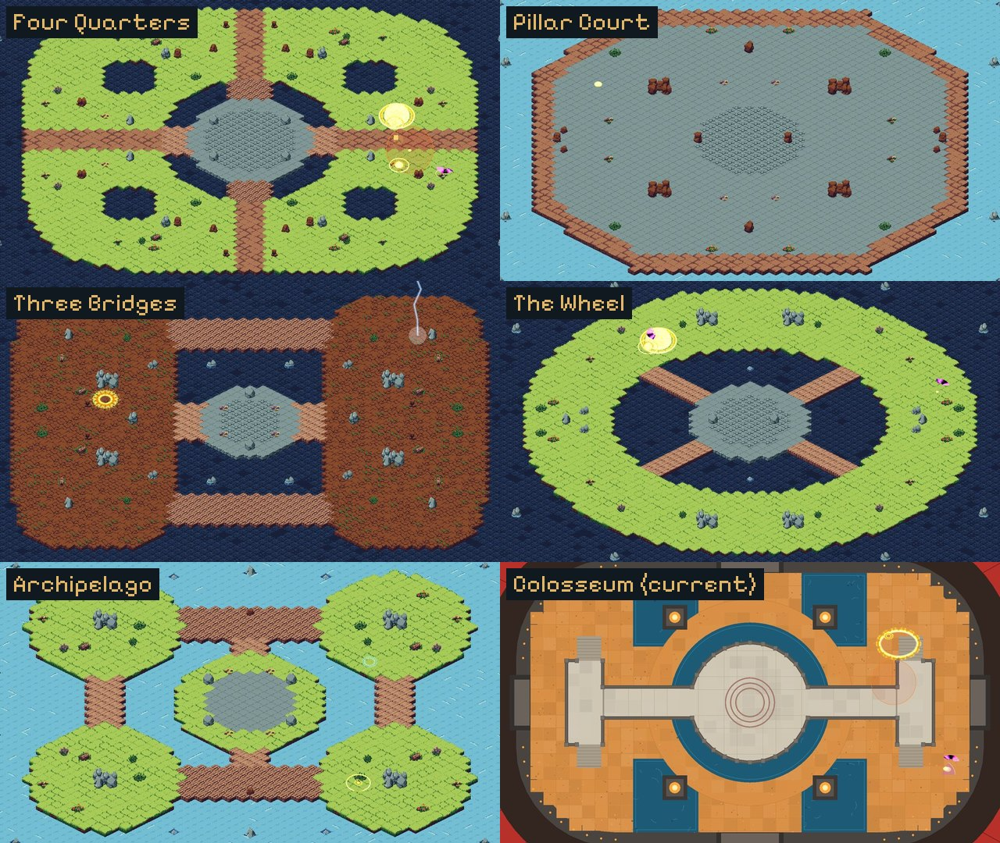

## How to review

1. Run the game, then **Practice vs Bots**. Use Left / Right on **Arena** to flip through the maps; the picture
   behind the menu is the real level.
2. Play a match on each. Four players (3 bots) and eight (7 bots) feel different.
3. To change a map, open its scene in `scenes/levels/` and paint. See [iso_level_editing.md](iso_level_editing.md).

## What I took from other games

| Source | What it does | Where it went |
|---|---|---|
| [WoW Nagrand Arena](https://liquipedia.net/worldofwarcraft/Nagrand_Arena) (search summary; the page itself would not load) | Four equal pillars round an open middle | Pillar Court |
| [WoW Blade's Edge Arena](https://warcraft.wiki.gg/wiki/Blade%27s_Edge_Arena) | Two start corners, a bridge, more than one way across | Three Bridges |
| [Omega Strikers arenas](https://omegastrikers.wiki.gg/wiki/Arena) | One strong idea per map, for example a hole in the middle you can be knocked into | Every map has one idea; The Wheel is the hole |
| [Battlerite maps](https://gamepressure.com/battlerite/maps/z69616) | A contested orb in the middle pulls fights together | Crown and rare drops at Center on every map |
| [League of Legends Arena](https://www.leagueoflegends.com/en-us/news/dev/dev-arena/) | Deep Water blocks walking but not sight | Water channels you can shoot across; Archipelago's dash gaps |
| [Deathmatch map flow](https://www.gamedeveloper.com/design/deathmatch-map-design-the-architecture-of-flow) | No dead ends, every strong spot has several entrances, symmetry for fair fights | Loops everywhere; all maps mirrored |
| [8 secrets of multiplayer maps](https://80.lv/articles/8-secrets-of-a-great-multiplayer-map/) | Flow first, spawns spread out, routes that use the game's movement, little visual noise | 8 spawns over 400 px apart; dash shortcuts; sparse decoration |
| [Melee level design](https://gamedeveloper.com/design/level-design-for-melee-combat-systems) | Open fighting space; stray low geometry breaks combos | Cover in clumps, not sprinkled |
| Brawl Stars map wiki (search summary) | Mirrored lanes; avoid one-tile gaps | Bridges at least 3 tiles wide |

These are mostly wikis and articles, not studios' design documents. The WoW and shooter advice comes from 3D games,
so treat it as a starting point.

## The arenas

**My pick:** keep **Four Quarters** as the default, and add **Archipelago** and **The Wheel** for variety. Offer
**Pillar Court** for 4 players only. **Three Bridges** needs a change first.

Bot matches, 150 s each. Deaths per minute is the pace; "drowned" is the share of deaths that were ring-outs.

| Arena | 8 players: deaths/min | 8 players: drowned | 4 players: deaths/min | 4 players: drowned |
|---|---|---|---|---|
| Four Quarters | 18-19 | 8-9% | 6 | 10% |
| Pillar Court | 28 | 3-4% | 10 | 8% |
| Three Bridges | 21 | 6-9% | 8 | 10% |
| The Wheel | 15-19 | 16-22% | 7 | 12% |
| Archipelago | 18 | 23-32% | 7 | 39% |
| Colosseum (current game) | 18-20 | 1-3% | 7 | 9% |

8-player numbers come from 3 matches per ruleset (Classic and Crown); 4-player numbers from only 2 Classic matches,
so read those as rough. Bots are not people: use this to compare maps, then trust your own match.

In the heat maps, bright = where bots spent time, white X = killed, blue X = drowned.

### Four Quarters

All-round. A moated crown circle with four bridges, four pools, rocks mirrored in each quarter.

| Layout | Bot heat map |
|---|---|
| 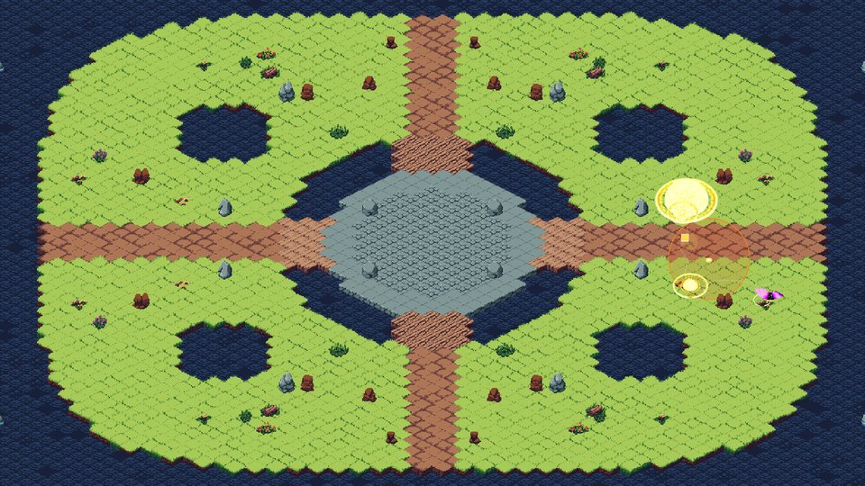 | 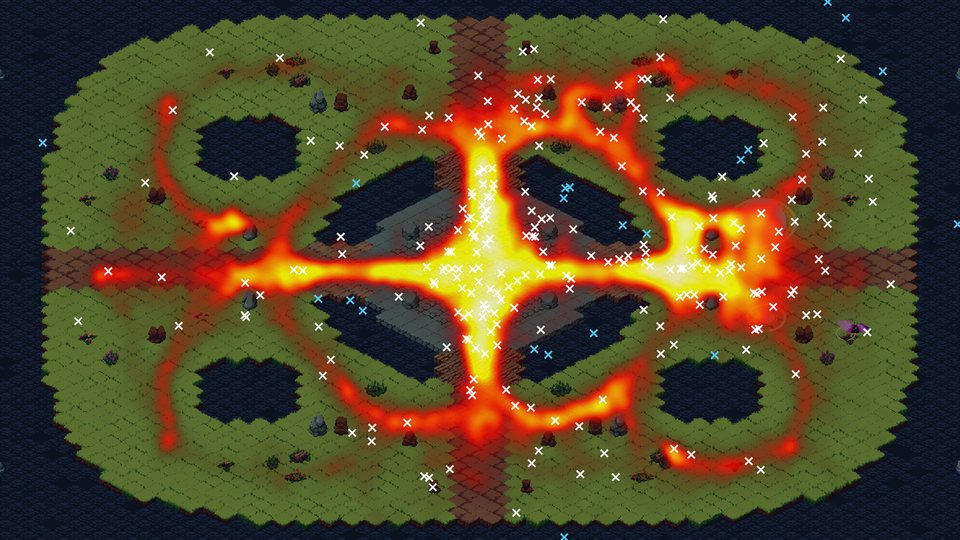 |

Fights gather at the crown and spill into the quarters. All four bridges get used. The outer quarters are quiet.

### Pillar Court

Line of sight. One open courtyard, four rock pillars, water only past the edge.

| Layout | Bot heat map |
|---|---|
| 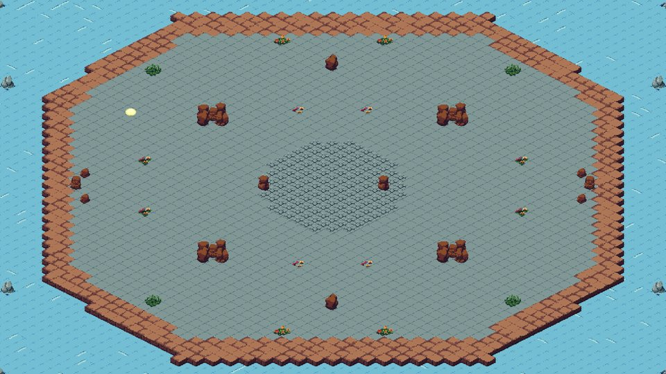 | 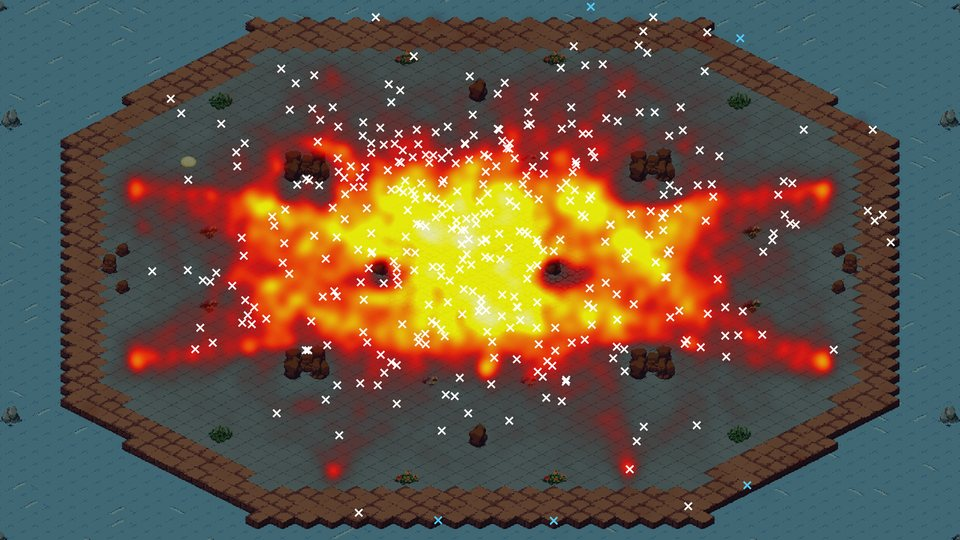 |

The fastest map by far: nothing separates players, so everyone meets in the middle. I widened it once (31 to 28 deaths a minute with 8). Few ring-outs. Good as a 4-player brawl; too hectic for 8.

### Three Bridges

Team lanes. Two home islands, a wide top and bottom bridge, a middle islet with the crown.

| Layout | Bot heat map |
|---|---|
| 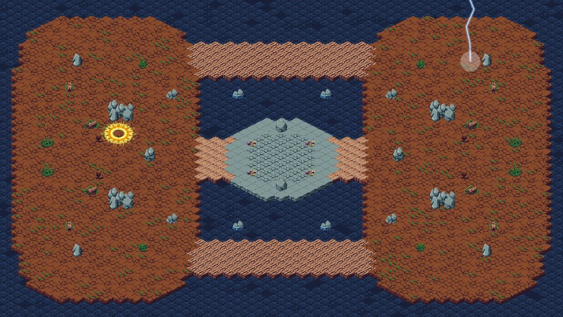 | 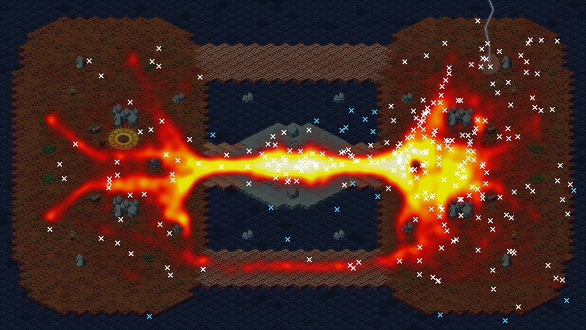 |

Not working as designed: bots pour through the middle, barely use the bottom bridge and ignore the top one. Ideas: put drops on the side bridges, or block the straight line through the middle with a pillar. Try it with human players first.

### The Wheel

Ring-outs. A ring road round the water, four spokes to a hub.

| Layout | Bot heat map |
|---|---|
| 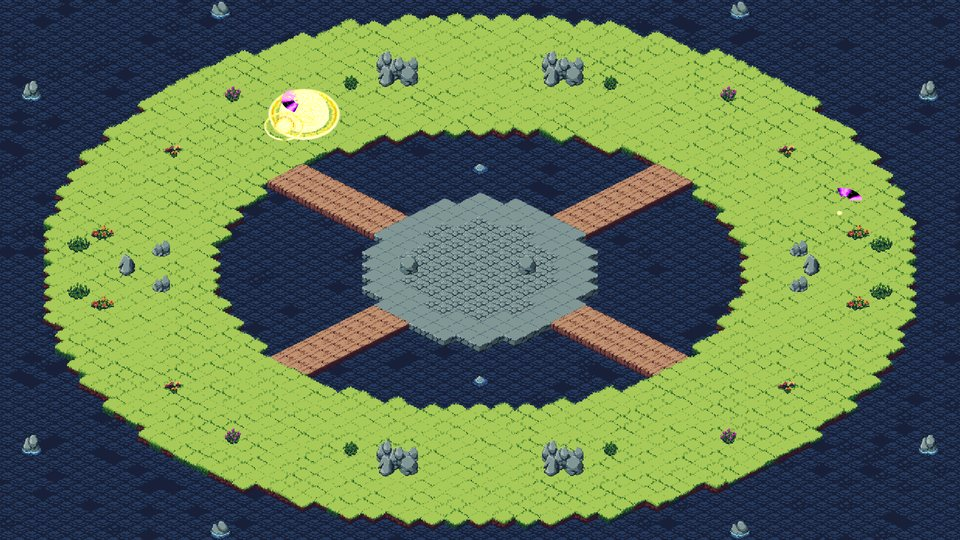 | 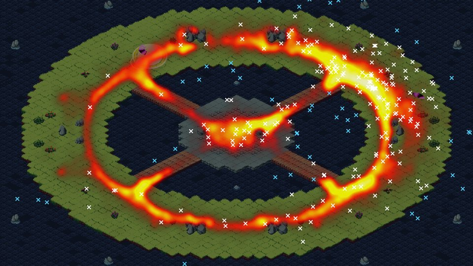 |

The loop works: no dead ends, and about one death in five is a drowning on 8 players. The spokes are narrow on purpose; widen them if it feels unfair.

### Archipelago

Mobility. A middle island, four corner islands, bridges round the outside. The diagonal channels (about 150 px) can be dashed.

| Layout | Bot heat map |
|---|---|
| 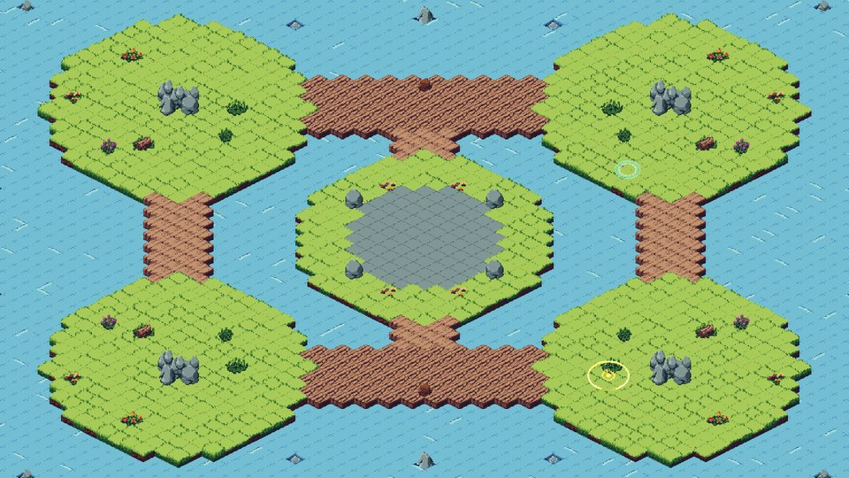 | 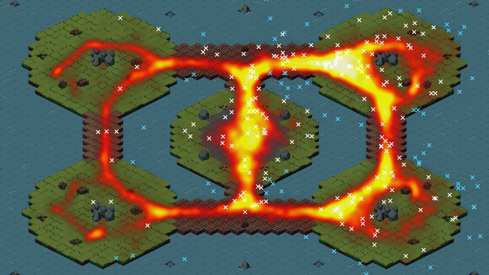 |

The most ring-outs, and the most different to play. 23 of 26 drownings in the re-check came within 1.5 s of a hit, so players are being knocked in rather than falling in by themselves. The left side is under-used (see below).

### Colosseum, for comparison

| Layout | Bot heat map |
|---|---|
| 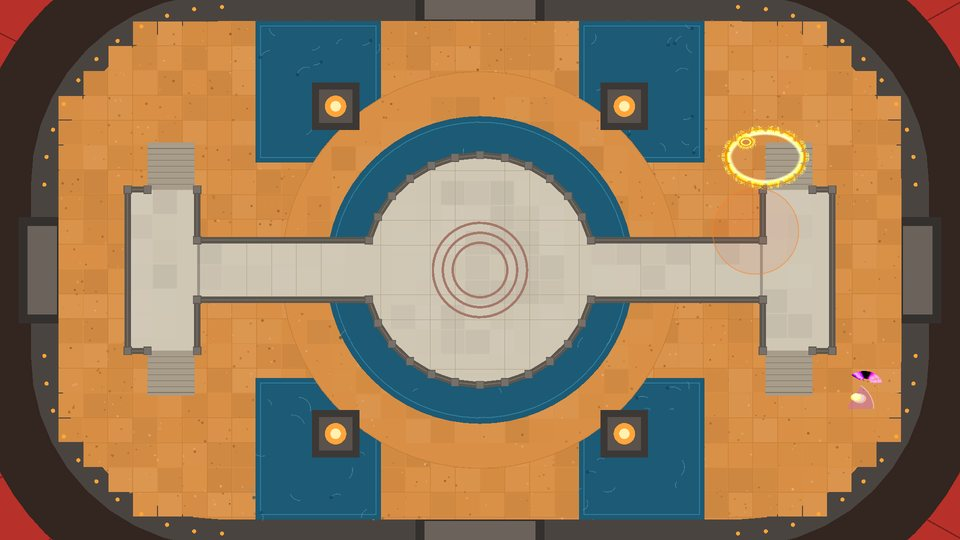 | 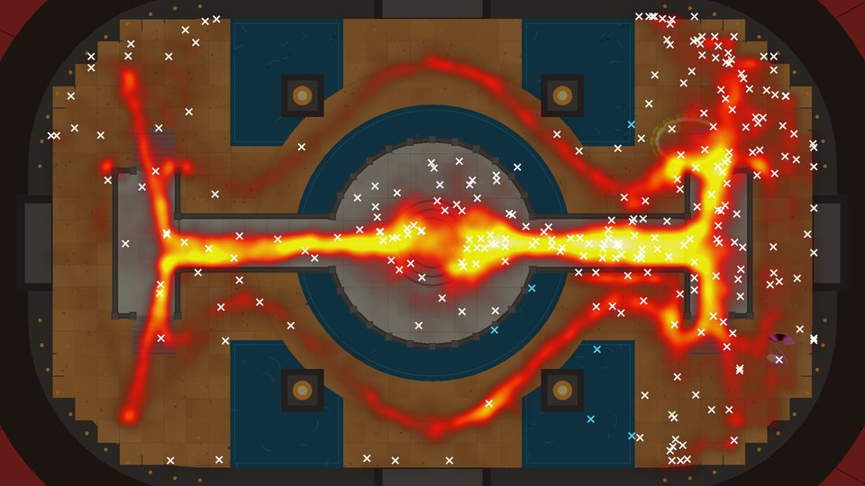 |

### Do not read left/right balance from the heat maps

Bots spend about two thirds of their off-centre time on the **right half** on every map except Pillar Court,
**including the current Colosseum** (66%). The layouts are mirrored, so this comes from the game or the bots, not the
maps. I have not found the cause.

## Main menu

| Before | After |
|---|---|
| 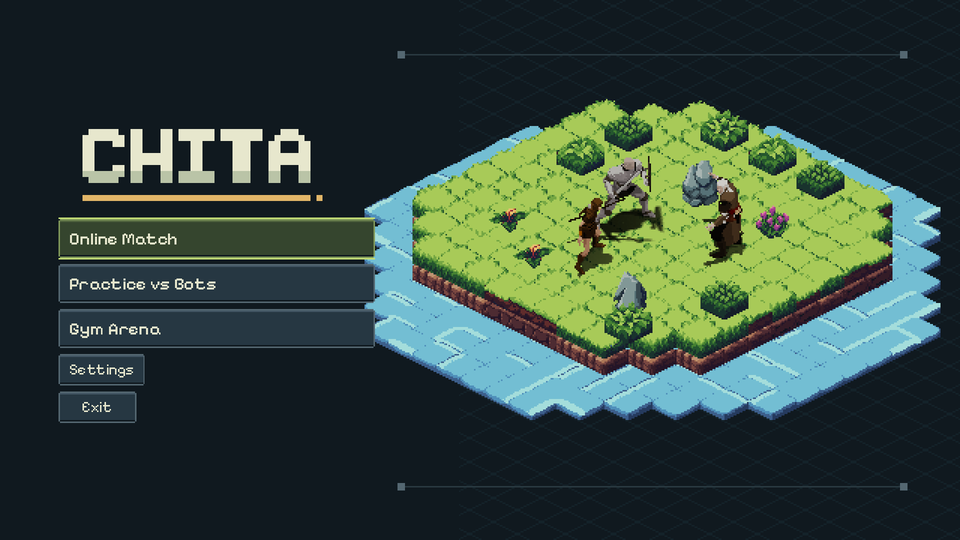 | 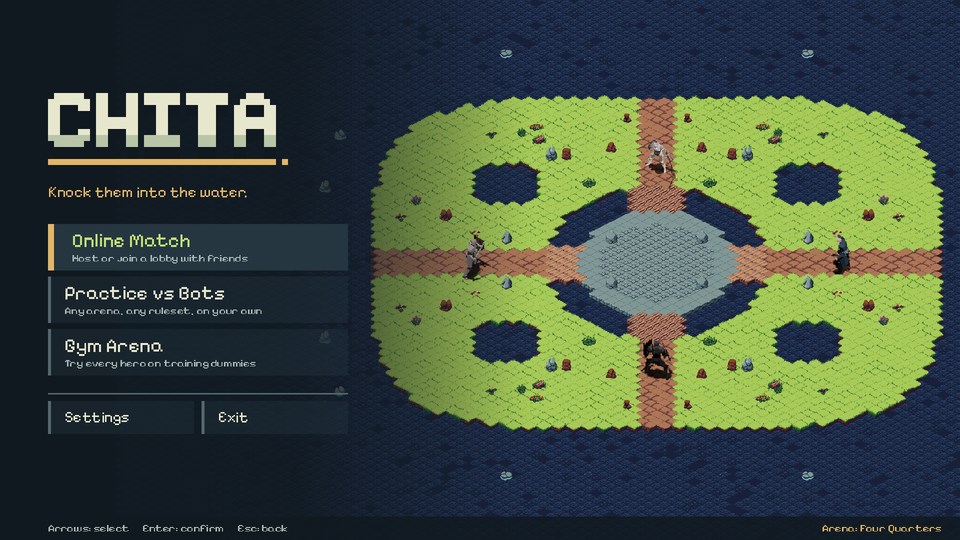 |
| 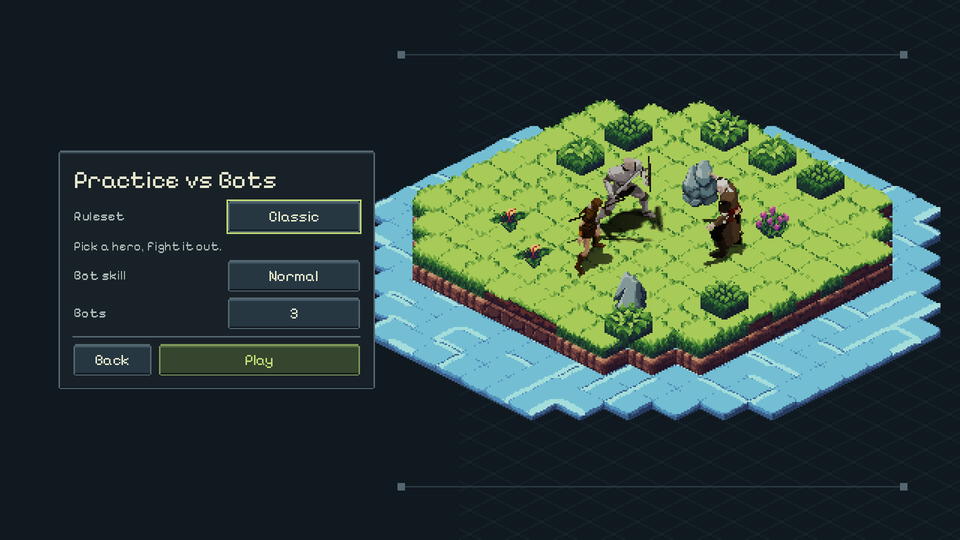 | 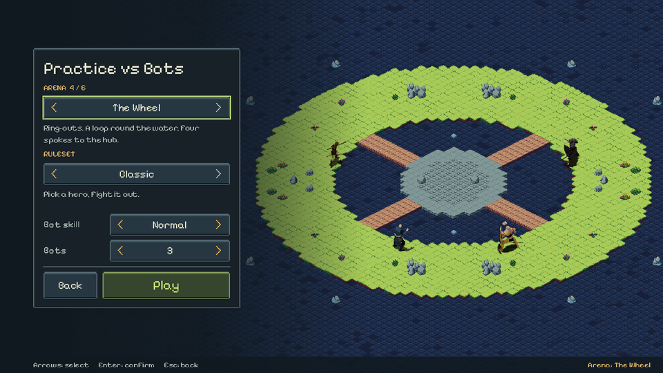 |
| 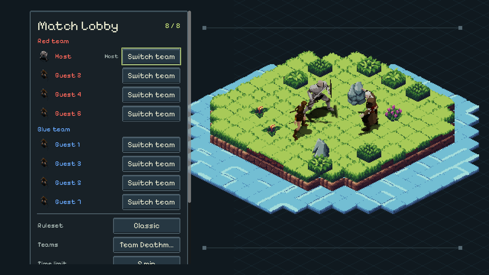 | 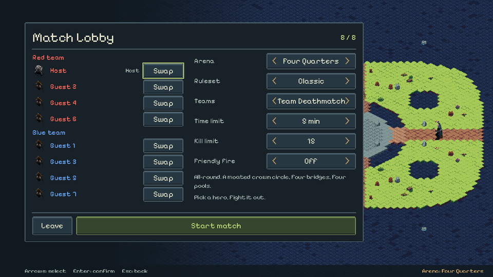 |

What was wrong, and what changed:

| Problem | Change |
|---|---|
| The art was one still picture unrelated to the match | The backdrop is the picked arena, live, with heroes standing in it |
| Three identical slabs, then two small buttons of different widths | One list with a title and a line of explanation each; Settings and Exit share a row |
| The focused entry was hard to tell from the primary button | A gold bar, a small slide and a green title on the one entry in focus; the mouse moves the same focus |
| Value buttons hid their other options and only cycled forward | `< value >` steppers: Left / Right, Enter, or click either side |
| With 8 players the lobby scrolled and **Start match was off screen** | Players and rules side by side, actions always visible |
| "Team Deathm..." was cut off | The wider column fits it |
| No hint how to drive the menu | Footer with the keys and the arena shown |

The pixel font, colours and button art are unchanged, so the HUD and hero pick still match.

## Checks

- **Level tests** (`iso_level`, 4 tests, all pass): every arena has 8 spawns on dry, connected ground, bots can walk
  from each spawn to the centre, props are solid, drops have room to spread, and every arena loads.
- **Whole suite inside a game process:** 155 tests, 7 fail (5 hero, 1 progression, 1 dash). The same 7 fail on the
  untouched last commit, so they predate this work.
- **Menu:** 13 scripted keyboard and mouse checks pass, from the first button into a match on the chosen arena.
  Screens checked at 16:9, 4:3 and ultrawide.
- **Online:** two game processes on one PC (the dev network mode): the player who joined loaded the host's arena.
  Not tested over Steam.
- **Not done:** nobody has played these by hand, and I have not tried editing a level with the mouse in the editor.

## Decisions for you

1. Which arenas stay? Delete a row in `scripts/world/arenas.gd` to drop one.
2. Commit? The menu needs `arenas.gd` (its backdrop is the arena), so arenas go first or together.
3. Two old problems I noticed and did **not** change, since both alter how the current game plays:
   - Drops fall in the **same places in the same order in every match**, on every map (the map's random generator
     has a fixed seed). A one-line fix.
   - A bot can keep walking toward a pickup that is already gone, which floods the log with "cannot be normalized"
     warnings. Also a small fix.
